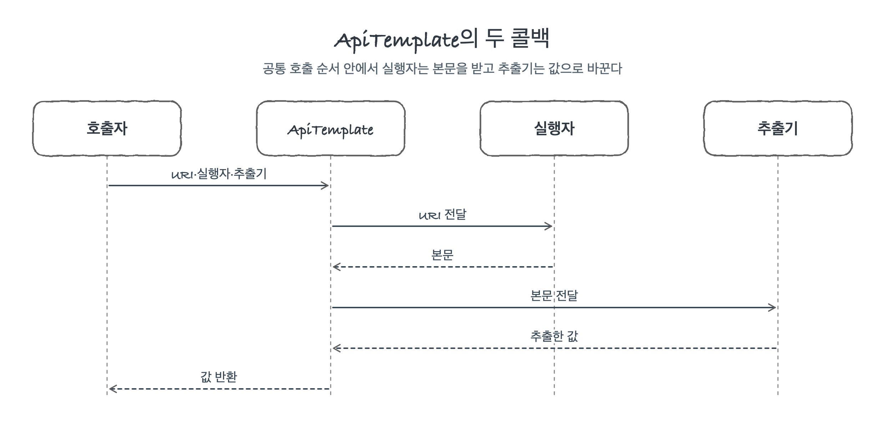

# Extracting ApiTemplate

ApiTemplate은 공통 실행 순서와 바꿀 수 있는 두 단계, 실행자와 추출기를 표현한다. 다음 예는 네트워크 없이 숫자 본문을 반환하는 콜백으로 구조를 보여준다. [Martin Fowler · Extract Function](https://refactoring.com/catalog/extractFunction.html) · [Spring 6.2 TransactionTemplate](https://docs.spring.io/spring-framework/reference/6.2/data-access/transaction/programmatic.html) · [Spring 6.2 REST Clients](https://docs.spring.io/spring-framework/reference/6.2/integration/rest-clients.html)

## 1. URI를 받아 호출하고 반환값을 추출한다

```java
import java.math.BigDecimal;
import java.net.URI;
import java.util.function.Function;

final class ApiTemplateExample {
    static <T> T execute(URI uri, Function<URI, String> fetch,
                         Function<String, T> extract) {
        return extract.apply(fetch.apply(uri));
    }

    public static void main(String[] args) {
        var endpoint = URI.create("https://example.invalid/rate");
        BigDecimal rate = execute(endpoint, ignored -> "1300", BigDecimal::new);
        if (!rate.equals(new BigDecimal("1300"))) {
            throw new AssertionError(rate);
        }
    }
}
```

실제 템플릿에서는 오류 변환과 자원 정리의 정책을 호출 흐름에 넣는다. 실행자와 추출기는 서로를 참조할 필요가 없도록 입력과 출력만 약속한다. [Spring 6.2 REST Clients](https://docs.spring.io/spring-framework/reference/6.2/integration/rest-clients.html) · [Spring 6.2 TransactionTemplate](https://docs.spring.io/spring-framework/reference/6.2/data-access/transaction/programmatic.html) · [Cockburn · Ports and Adapters](https://alistair.cockburn.us/hexagonal-architecture?trk=public_post_comment-text)



그림의 근거 · [Martin Fowler · Extract Function](https://refactoring.com/catalog/extractFunction.html) · [Spring 6.2 TransactionTemplate](https://docs.spring.io/spring-framework/reference/6.2/data-access/transaction/programmatic.html) · [Spring 6.2 REST Clients](https://docs.spring.io/spring-framework/reference/6.2/integration/rest-clients.html)

## 2. 공통 정책을 바꿀 때 기존 사용자도 검증한다

호출자 둘 이상이 공통 규칙을 공유하는지 확인한다. 서로 다른 실패 정책까지 한 템플릿에 넣어 복잡해진다면 설정 옵션의 비용과 별도 구현을 비교한다. [Robert C. Martin · Open–Closed Principle](https://blog.cleancoder.com/uncle-bob/2014/05/12/TheOpenClosedPrinciple.html) · [Spring 6.2 REST Clients](https://docs.spring.io/spring-framework/reference/6.2/integration/rest-clients.html)
