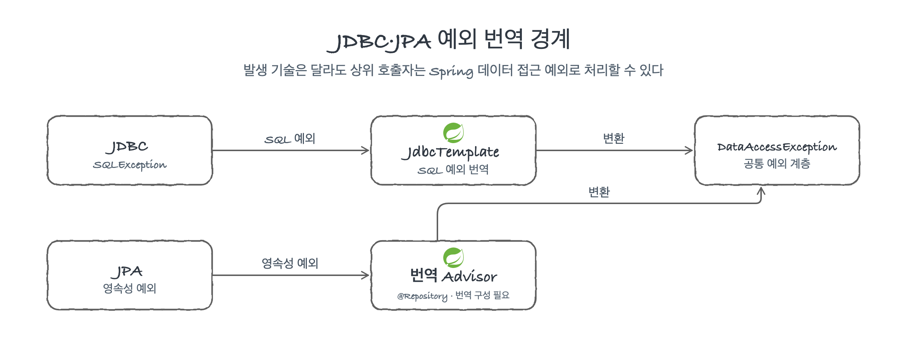

# Translating Data Access Exceptions

Spring은 JDBC나 JPA의 예외를 DataAccessException 계층으로 해석할 수 있다. 상위 호출자는 데이터 접근 실패 유형을 공통 방식으로 다루고, 업무 의미를 부여하는 규칙은 별도로 정한다. [Spring 6.2 DAO Support](https://docs.spring.io/spring-framework/reference/6.2/data-access/dao.html) · [Spring 6.2 DataAccessException](https://docs.spring.io/spring-framework/docs/6.2.x/javadoc-api/org/springframework/dao/DataAccessException.html)

## 1. 자동 번역이 걸리는 위치를 확인한다

JdbcTemplate은 JDBC SQLException을 변환한다. JPA 어댑터에서는 적절한 번역기와 PersistenceExceptionTranslationPostProcessor가 등록된 환경에서 @Repository 빈에 번역 Advisor를 적용할 수 있다. [Spring 6.2 JdbcTemplate](https://docs.spring.io/spring-framework/reference/6.2/data-access/jdbc/core.html) · [Spring 6.2 PersistenceExceptionTranslationPostProcessor](https://docs.spring.io/spring-framework/docs/6.2.x/javadoc-api/org/springframework/dao/annotation/PersistenceExceptionTranslationPostProcessor.html)

그림의 근거 · [Spring 6.2 JdbcTemplate](https://docs.spring.io/spring-framework/reference/6.2/data-access/jdbc/core.html) · [Spring 6.2 PersistenceExceptionTranslationPostProcessor](https://docs.spring.io/spring-framework/docs/6.2.x/javadoc-api/org/springframework/dao/annotation/PersistenceExceptionTranslationPostProcessor.html)

## 2. 예외 변환이 잃어버리면 안 되는 정보를 남긴다

무결성 제약 위반의 원인은 유일 제약뿐 아니라 외래 키나 필수 값 등일 수 있다. 특정 업무 예외로 바꿀 때는 DB의 제약과 오류 원인을 확인하고 원인 예외를 보존한다. [Spring 6.2 DataAccessException](https://docs.spring.io/spring-framework/docs/6.2.x/javadoc-api/org/springframework/dao/DataAccessException.html) · [Spring 6.2 DAO Support](https://docs.spring.io/spring-framework/reference/6.2/data-access/dao.html)
