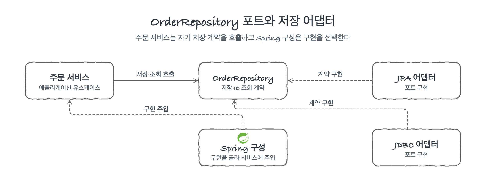

# Applying DIP to OrderRepository

OrderRepository의 계약은 주문을 사용하는 애플리케이션이 정한다. DB 기술이 바뀌어도 주문 유스케이스는 같은 저장·조회 규약을 호출하는 구성을 목표로 한다. [Cockburn · Ports and Adapters](https://alistair.cockburn.us/hexagonal-architecture?trk=public_post_comment-text) · [Martin Fowler · Repository](https://martinfowler.com/eaaCatalog/repository.html)

## 1. 포트가 필요한 연산만 공개한다

Order를 저장하고 ID로 찾는 계약에 업무 객체와 식별자를 쓴다. 조회 결과가 없을 때 처리 방식과 동시 변경 충돌 조건을 계약에 적는다. SQL이나 EntityManager 호출은 구현 클래스의 세부사항으로 둔다. [Martin Fowler · Repository](https://martinfowler.com/eaaCatalog/repository.html) · [Cockburn · Ports and Adapters](https://alistair.cockburn.us/hexagonal-architecture?trk=public_post_comment-text) · [Jakarta Persistence 3.1](https://jakarta.ee/specifications/persistence/3.1/jakarta-persistence-spec-3.1.html)

## 2. Spring 구성은 안쪽 계약과 바깥 구현을 연결한다

JPA 또는 JDBC 어댑터를 구성에서 등록해 서비스에 주입한다. 공통 계약 테스트에서는 저장 후 조회, 존재하지 않는 ID, 제약 위반처럼 각 구현이 유지해야 하는 결과를 확인한다. [Spring 6.2 DI](https://docs.spring.io/spring-framework/reference/6.2/core/beans/dependencies/factory-collaborators.html) · [Martin Fowler · Repository](https://martinfowler.com/eaaCatalog/repository.html) · [Spring 6.2 DAO Support](https://docs.spring.io/spring-framework/reference/6.2/data-access/dao.html)

그림의 근거 · [Spring 6.2 DI](https://docs.spring.io/spring-framework/reference/6.2/core/beans/dependencies/factory-collaborators.html) · [Martin Fowler · Repository](https://martinfowler.com/eaaCatalog/repository.html) · [Spring 6.2 DAO Support](https://docs.spring.io/spring-framework/reference/6.2/data-access/dao.html)
