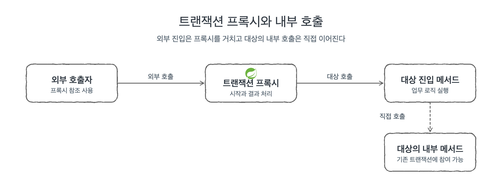

# Introducing a Transaction Proxy

트랜잭션 프록시는 호출자가 사용하던 서비스 계약을 제공하면서 대상 호출 바깥에 트랜잭션 처리를 배치한다. 실제 업무 동작은 대상 객체가 수행한다. [Spring 6.2 AOP Proxying](https://docs.spring.io/spring-framework/reference/6.2/core/aop/proxying.html) · [Spring 6.2 @Transactional](https://docs.spring.io/spring-framework/reference/6.2/data-access/transaction/declarative/annotations.html) · [Spring 6.2 TransactionTemplate](https://docs.spring.io/spring-framework/reference/6.2/data-access/transaction/programmatic.html)

## 1. 외부에서 대상에 들어가는 경로를 본다

호출자 → 프록시 → 대상 메서드 순서로 실행한다. 프록시가 트랜잭션 시작과 결과 처리를 맡고 대상이 저장을 조정한다. 호출자가 프록시를 통과하는 객체 참조를 받았는지 확인한다. [Spring 6.2 AOP Proxying](https://docs.spring.io/spring-framework/reference/6.2/core/aop/proxying.html) · [Spring 6.2 @Transactional](https://docs.spring.io/spring-framework/reference/6.2/data-access/transaction/declarative/annotations.html)

## 2. 프록시를 건너뛰는 호출을 찾는다

직접 생성한 대상 객체나 일반 프록시 모드에서의 내부 메서드 호출은 새 트랜잭션 조언을 거치지 않는다. 내부 메서드는 외부 호출에서 이미 시작된 트랜잭션 안에서 실행될 수 있으므로, 원하는 경계와 실제 호출 경로를 대조한다. [Spring 6.2 AOP Proxying](https://docs.spring.io/spring-framework/reference/6.2/core/aop/proxying.html) · [Spring 6.2 @Transactional](https://docs.spring.io/spring-framework/reference/6.2/data-access/transaction/declarative/annotations.html)

그림의 근거 · [Spring 6.2 AOP Proxying](https://docs.spring.io/spring-framework/reference/6.2/core/aop/proxying.html) · [Spring 6.2 @Transactional](https://docs.spring.io/spring-framework/reference/6.2/data-access/transaction/declarative/annotations.html)
