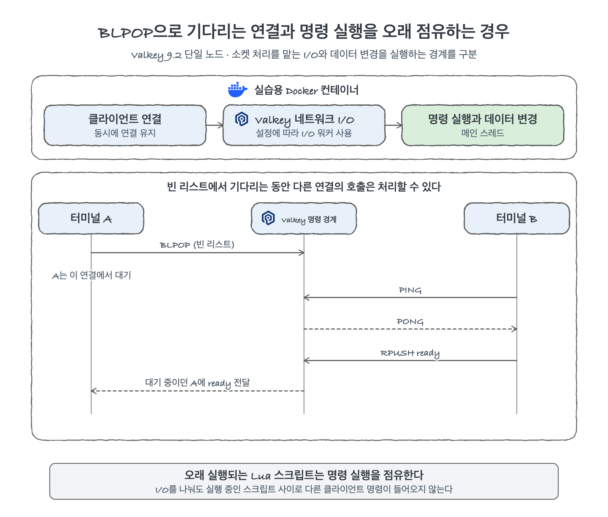

# Valkey Fundamentals and Command Execution

Valkey는 문자열뿐 아니라 해시, 리스트, 정렬 집합, 스트림 등을 메모리에서 다루는 키-값 저장소다. Linux Foundation 산하에서 Redis OSS 7.2.4를 기반으로 시작했다. 기존 Redis 명령과 RESP 프로토콜 경험을 활용할 수 있으며, 신규 명령·설정·모듈·영속 파일의 호환 범위는 출발 버전과 도착 버전별로 확인한다. [Valkey 7.2](https://valkey.io/download/7.2/) · [Redis에서 Valkey로 마이그레이션](https://valkey.io/topics/migration/)

## 1. Docker에서 실행

이 시리즈는 공식 `valkey/valkey:9.2.0` 이미지를 사용한다. 단일 노드 실습은 호스트 루프백에만 공개한다. 이 컨테이너는 명령 예제를 위해 RDB와 AOF를 끈다. 영속성은 [06번](06_valkey_persistence_memory_and_high_availability.md)의 별도 컨테이너에서 확인한다. [Valkey 9.2 다운로드](https://valkey.io/download/9.2/)

```bash
docker run --rm -d --name valkey-lab \
  -p 127.0.0.1:16379:6379 \
  valkey/valkey:9.2.0 valkey-server --save "" --appendonly no

vk() { docker exec valkey-lab valkey-cli --raw "$@"; }

vk PING
vk INFO server | rg '^valkey_version:'
vk SET lab:hello world
vk GET lab:hello
```

`vk` 함수는 터미널을 새로 열면 다시 정의한다. `INFO server`에서 실행 중인 Valkey 버전은 `valkey_version`으로 확인한다. 호환 목적으로 표시되는 `redis_version`은 Valkey 자체 버전을 나타내지 않는다. [Valkey INFO](https://valkey.io/commands/info/)

## 2. 명령 실행과 동시 연결

단일 노드에서 하나의 명령이 데이터를 바꾸는 동안 다른 클라이언트의 명령이 중간에 끼어들지 않는다. 여러 클라이언트 연결은 동시에 유지할 수 있다. 네트워크 I/O와 백그라운드 저장 같은 작업에는 별도 스레드나 프로세스가 쓰일 수 있다. 한 클라이언트의 `GET`과 이후 `SET` 사이에는 다른 쓰기가 들어올 수 있으므로, 해당 경쟁은 [원자적 연산 실습](04_valkey_atomic_operations_transactions_and_locks.md)에서 따로 다룬다. [Valkey 지연 진단](https://valkey.io/topics/latency/) · [Valkey 8.0 I/O 개선](https://valkey.io/download/8.0/)

터미널 A에서 빈 리스트에 `BLPOP`을 걸고, 20초 이내에 터미널 B에서 `PING`과 `RPUSH`를 실행한다. A는 항목이 들어오기를 기다리고 B는 즉시 응답을 받는다.

```bash
# 터미널 A
docker exec valkey-lab valkey-cli BLPOP lab:blocking-example 20
```

```bash
# 터미널 B
docker exec valkey-lab valkey-cli PING
docker exec valkey-lab valkey-cli RPUSH lab:blocking-example ready
```

차단 목록 명령은 조건이 충족될 때까지 해당 연결을 대기시킨다. 큰 키에 대한 비싼 명령이나 긴 Lua 스크립트는 명령 실행 자체를 오래 점유할 수 있다. 두 경우의 영향을 구분해 지연을 진단한다. [BLPOP](https://valkey.io/commands/blpop/) · [Lua 스크립팅](https://valkey.io/topics/eval-intro/)



그림의 근거 · [Valkey 9.2.0 I/O Threads 설계](https://github.com/valkey-io/valkey/blob/9.2.0/design-docs/io-threads.md) · [Valkey BLPOP](https://valkey.io/commands/blpop/) · [Valkey Lua 스크립팅](https://valkey.io/topics/eval-intro/)
