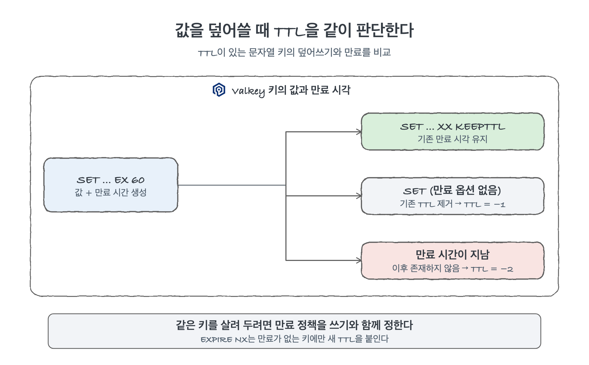
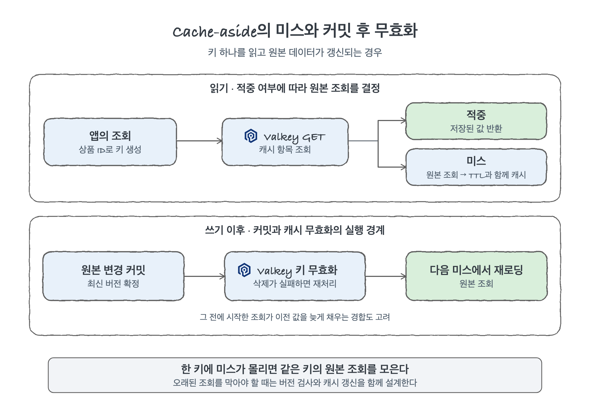

# Valkey Caching, TTL, and Invalidation

캐시는 자주 읽는 값을 원본 저장소보다 가까운 곳에서 빠르게 반환한다. Cache-aside에서는 캐시에서 먼저 읽고, 값이 없으면 원본에서 조회한 뒤 TTL을 설정해 저장한다. 캐시가 비었을 때 원본이 감당할 부하와, 응답이 얼마나 오래된 값을 허용하는지를 함께 정한다.

## 1. 키 수명과 조건부 저장

[단일 노드 실습](01_valkey_fundamentals_and_command_execution.md)의 `vk` 함수를 사용한다.

```bash
vk SET lab:product:1 '{"id":1,"name":"Keyboard"}' EX 60
vk TTL lab:product:1
vk SET lab:product:1 '{"id":1,"name":"Compact keyboard"}' XX KEEPTTL
vk PTTL lab:product:1
vk SET lab:product:1 '{"id":1,"name":"Keyboard"}'
vk TTL lab:product:1
vk EXPIRE lab:product:1 60 NX
vk PERSIST lab:product:1
vk TTL lab:product:missing
```

`EX`는 초, `PX`는 밀리초이며 `EXAT`와 `PXAT`는 절대 만료 시각이다. `NX`는 키가 없을 때, `XX`는 키가 있을 때만 `SET`을 적용한다. 보통 `SET`으로 값을 교체하면 기존 TTL이 사라지며 `KEEPTTL`로 유지할 수 있다. `TTL`은 만료가 없는 키에 `-1`, 존재하지 않는 키에 `-2`를 반환한다. `EXPIRE … NX`는 만료가 없는 키에만 TTL을 붙인다. `PERSIST`는 TTL을 제거한다. [SET](https://valkey.io/commands/set/) · [EXPIRE](https://valkey.io/commands/expire/) · [TTL](https://valkey.io/commands/ttl/)

만료된 키는 접근할 때 제거될 수 있고, Valkey는 접근이 없는 키도 주기적으로 검사해 제거한다. 만료 시각과 메모리에서 실제로 정리되는 시점에는 차이가 있을 수 있다. [키 만료 동작](https://valkey.io/commands/expire/)



그림의 근거 · [Valkey SET](https://valkey.io/commands/set/) · [Valkey EXPIRE](https://valkey.io/commands/expire/) · [Valkey TTL](https://valkey.io/commands/ttl/)

## 2. 객체 캐시와 여러 키 처리

객체를 JSON 문자열로 저장하면 한 번에 읽고 갱신하기 쉽다. 일부 필드만 자주 고친다면 Hash를 고려한다. `MGET`은 여러 문자열 키를 한 번에 읽는다. `MSET`은 값을 묶어서 교체하지만 키별 TTL을 받지 않으며 덮어쓴 키의 기존 TTL은 사라진다.

키마다 TTL을 설정하면서 두 쓰기 사이에 다른 명령이 들어오지 않게 하려면 같은 연결에서 `MULTI`와 `EXEC`를 쓴다.

```bash
docker exec -i valkey-lab valkey-cli --raw <<'COMMANDS'
MULTI
SET lab:catalog:1 "{\"id\":1}" EX 60
SET lab:catalog:2 "{\"id\":2}" EX 120
EXEC
MGET lab:catalog:1 lab:catalog:2
COMMANDS
```

파이프라이닝도 여러 명령을 보내지만, 그 자체로 명령 사이의 끼어들기를 막지 않는다. 읽기 여러 건의 왕복을 줄이는 데 사용하고, 관련 쓰기를 함께 적용해야 할 때는 트랜잭션이나 원자적인 명령을 고른다. Cluster에서는 여러 키를 쓰는 명령에 같은 슬롯 조건이 적용될 수 있다. [MGET](https://valkey.io/commands/mget/) · [MSET](https://valkey.io/commands/mset/) · [Transactions](https://valkey.io/topics/transactions/) · [Pipelining](https://valkey.io/topics/pipelining/)

## 3. 무효화와 캐시 스탬피드

| 상황 | 대응 |
| --- | --- |
| 원본 수정 후 캐시가 오래 남음 | 원본 커밋 후 관련 키를 무효화한다. 삭제 실패는 재처리하고 TTL로 최대 잔존 시간을 제한한다. |
| 읽기가 예전 값을 다시 채움 | 무효화와 진행 중인 조회가 교차하는 경우를 테스트한다. 오래된 조회 결과를 차단해야 하면 원본 버전을 캐시 키나 조건부 갱신에 반영한다. |
| 인기 키가 만료되어 원본 요청 급증 | 같은 키의 조회를 한 작업으로 모은다. 다수 키가 한꺼번에 만료되는 경우 TTL에 작은 무작위 편차를 준다. |
| 존재하지 않는 키를 반복 조회 | 짧게 미존재 결과를 캐싱하고, 새로 생성될 때 해당 키도 무효화한다. |

운영에서는 적중률과 함께 실제 원본 조회 수, 캐시 미스 경로의 지연, 만료·퇴출 수를 본다. 같은 키가 한 노드에 집중되는 문제는 [메모리와 가용성](06_valkey_persistence_memory_and_high_availability.md)에서 이어서 다룬다. [Cache stampede 완화](../cache/06_mitigating_cache_stampedes.md)



그림의 근거 · [Microsoft Cache-Aside](https://learn.microsoft.com/en-us/azure/architecture/patterns/cache-aside) · [Cloudflare Request collapsing](https://developers.cloudflare.com/cache/concepts/default-cache-behavior/#request-collapsing)
