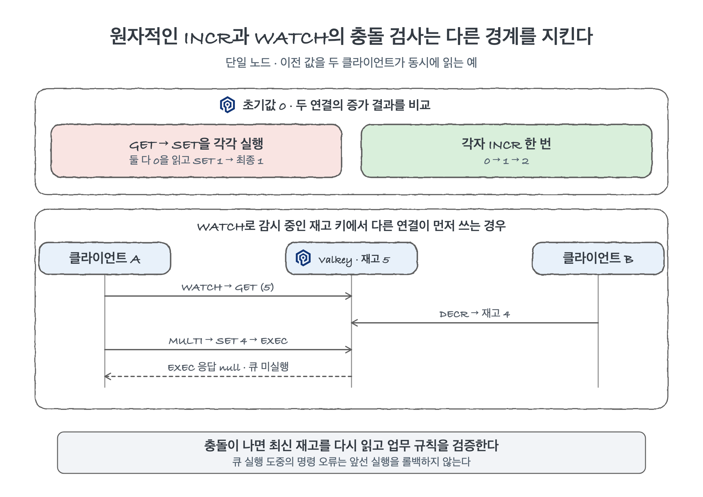
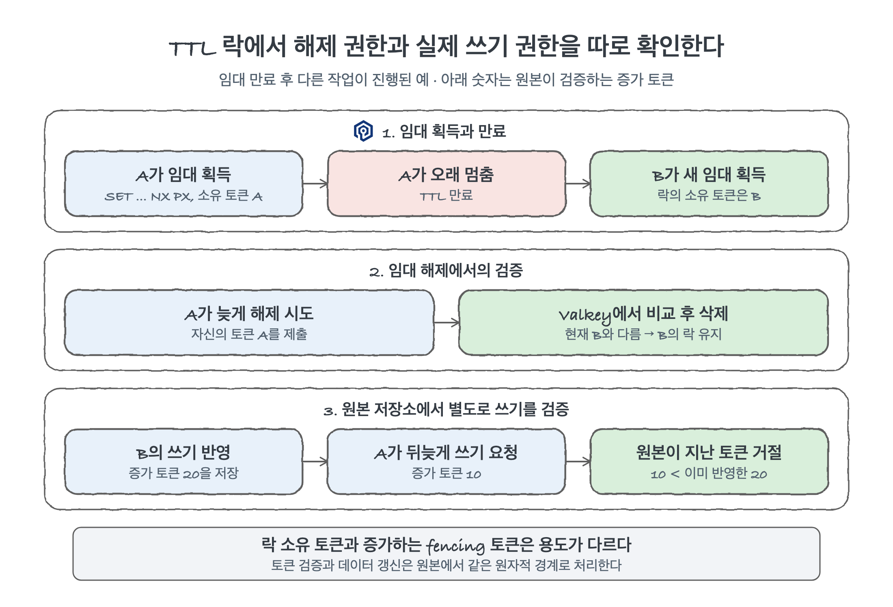

# Valkey Atomic Operations, Transactions, and Locks

Valkey가 단일 명령을 원자적으로 실행해도 클라이언트가 여러 명령으로 나눈 작업에는 경쟁 조건이 생긴다. 결제나 재고처럼 원본 저장소의 정합성이 필요한 작업은 Valkey 명령 경계와 원본 트랜잭션 경계를 함께 설계한다.

## 1. Lost update와 원자적인 증가

카운터가 0일 때 A와 B가 모두 `GET`으로 0을 읽고 각각 `SET … 1`을 실행하면 최종 값은 1이다. 계산을 클라이언트로 가져오지 않고 `INCR`로 호출하면 두 증가가 모두 적용된다.

```bash
vk SET lab:counter 0
vk INCR lab:counter
vk INCR lab:counter
vk GET lab:counter
```

이 실습의 최종 값은 2다. 키의 자료형과 작업에 맞는 `HINCRBY`·`ZINCRBY` 등도 같은 방식으로 경쟁 구간을 줄인다. [INCR](https://valkey.io/commands/incr/)

## 2. MULTI, EXEC, WATCH

`MULTI`는 뒤따르는 명령을 큐에 담고 `EXEC`는 큐를 순서대로 실행한다. `WATCH`는 감시한 값이 바뀌면 트랜잭션을 실행하지 않는 낙관적 제어다. 두 터미널에서 각각 `docker exec -it valkey-lab valkey-cli`를 실행해 같은 연결을 유지한다.

```text
A> SET lab:stock 5
A> WATCH lab:stock
A> GET lab:stock
B> DECR lab:stock
A> MULTI
A> SET lab:stock 4
A> EXEC
```

B의 쓰기 때문에 A의 `EXEC`는 빈 배열과 구별되는 null 응답을 반환한다. A는 최신 값을 읽고 필요한 경우 다시 시도한다. 명령 문법 오류로 큐 등록이 실패하면 `EXEC`가 전체 실행을 거부할 수 있다. 큐에 등록된 명령이 실행 시점에 잘못된 타입으로 실패하면 이미 실행한 명령이나 뒤따르는 명령을 롤백하지 않는다. [Transactions](https://valkey.io/topics/transactions/) · [WATCH](https://valkey.io/commands/watch/)



그림의 근거 · [Valkey INCR](https://valkey.io/commands/incr/) · [Valkey Transactions](https://valkey.io/topics/transactions/) · [Valkey WATCH](https://valkey.io/commands/watch/)

## 3. Lua와 TTL 기반 락

`SET … NX PX`로 짧은 임대를 얻는다. 요청마다 고유한 토큰을 만들고, 획득한 요청만 작업한다. 해제 시점에는 자신이 받은 토큰과 현재 값을 함께 비교한다. 아래 값은 실습을 위한 고정 토큰이다.

```bash
vk SET lab:lock:42 owner-a NX PX 30000
vk SET lab:lock:42 owner-b NX PX 30000

vk EVAL '
  if redis.call("GET", KEYS[1]) == ARGV[1] then
    return redis.call("DEL", KEYS[1])
  end
  return 0
' 1 lab:lock:42 owner-b

vk EVAL '
  if redis.call("GET", KEYS[1]) == ARGV[1] then
    return redis.call("DEL", KEYS[1])
  end
  return 0
' 1 lab:lock:42 owner-a
```

B의 해제 결과는 0이고 A의 해제 결과는 1이다. Valkey 9.0 이상에서는 같은 비교 후 삭제를 `DELIFEQ` 한 번으로 처리할 수 있다. Lua 스크립트는 실행 중 다른 명령이 끼어들지 않지만, 스크립트 오류가 이미 수행한 쓰기를 되돌리지는 않는다. Cluster에서 여러 키를 읽거나 수정하는 스크립트는 키를 `KEYS`로 전달하고 같은 슬롯에 배치한다. [Lua scripting](https://valkey.io/topics/eval-intro/) · [DELIFEQ](https://valkey.io/commands/delifeq/)

프로세스가 오래 멈추면 임대가 만료된 후에도 원래 작업이 재개될 수 있다. 비동기 복제 중 프라이머리가 장애를 겪으면 승격된 레플리카에 락이 없을 수도 있다. 상태 변경을 반드시 한 번만 반영해야 한다면 원본 저장소의 조건부 갱신이나 유일 제약으로 막는다. 이전 소유자의 늦은 요청을 거부해야 한다면, 일관된 발급처의 증가 토큰을 받고 실제로 쓰기를 수행하는 저장소가 그 토큰을 검증하도록 설계한다. [Distributed locks](https://valkey.io/topics/distlock/) · [Replication](https://valkey.io/topics/replication/)



그림의 근거 · [Valkey Distributed Locks](https://valkey.io/topics/distlock/) · [Valkey DELIFEQ](https://valkey.io/commands/delifeq/) · [Martin Kleppmann · Fencing tokens](https://martin.kleppmann.com/2016/02/08/how-to-do-distributed-locking.html)
