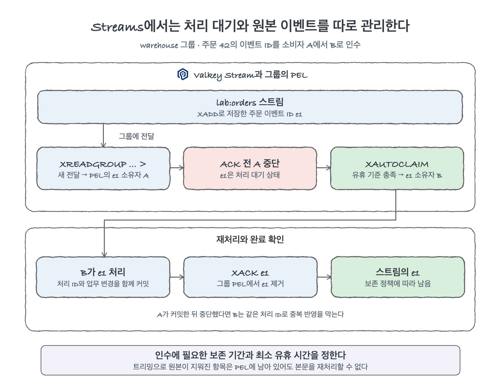
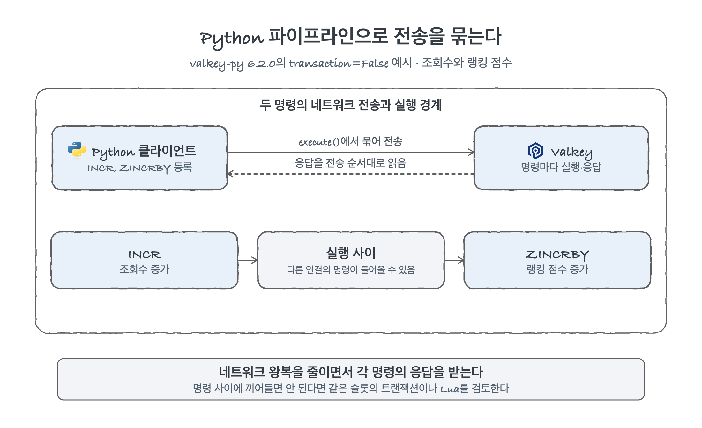

# Valkey Messaging, Streams, and Application Integration

메시지 처리 방식은 소비자가 잠시 끊겼을 때 이벤트를 다시 받을 수 있어야 하는지, 처리 완료를 기록해야 하는지에 따라 고른다.

## 1. List와 Pub/Sub

| 방식 | 동작 | 적합한 경우 |
| --- | --- | --- |
| List | `LPUSH`로 넣고 `BRPOP`으로 꺼낸다. 꺼낸 뒤 소비자가 중단되면 목록에서 이미 빠진 상태다. | 단순한 작업 대기열 |
| Pub/Sub | `PUBLISH` 시점에 연결된 `SUBSCRIBE` 구독자에게 메시지가 전달된다. 끊긴 동안의 이벤트는 저장되지 않는다. | 즉시성이 중요한 실시간 알림 |
| Stream | ID가 있는 이벤트를 저장하며 소비자 그룹이 읽기 위치와 처리 대기 항목을 관리한다. | 재처리와 진행 상태가 필요한 이벤트 |

```bash
vk LPUSH lab:jobs 'resize:42'
vk BRPOP lab:jobs 1
```

List에서 처리 복구가 필요하면 `BLMOVE`로 작업을 처리 중인 목록으로 옮기고, 성공 후 제거하며, 오래 남은 작업을 복구하는 규칙을 추가할 수 있다. Pub/Sub은 한 터미널에서 `vk SUBSCRIBE lab:notifications`를 실행하고 다른 터미널에서 `vk PUBLISH lab:notifications ready`를 보내 확인한다. [BLMOVE](https://valkey.io/commands/blmove/) · [Pub/Sub](https://valkey.io/topics/pubsub/)

## 2. Stream과 Consumer Group

[단일 노드 실습](01_valkey_fundamentals_and_command_execution.md)에서 아래 명령을 실행한다. 새 그룹을 `0-0` 위치에서 만들면 기존 이벤트도 읽을 수 있다. 생성 시점 이후의 이벤트만 필요하면 `$`를 사용한다. 그룹은 한 번만 만들며, 이미 존재한다면 같은 그룹을 재사용한다.

```bash
vk XGROUP CREATE lab:orders warehouse 0-0 MKSTREAM
event_id=$(vk XADD lab:orders '*' type order-created orderId 42)
vk XREADGROUP GROUP warehouse worker-a COUNT 1 STREAMS lab:orders '>'
vk XPENDING lab:orders warehouse
vk XAUTOCLAIM lab:orders warehouse worker-b 0 0-0 COUNT 1
vk XACK lab:orders warehouse "$event_id"
vk XPENDING lab:orders warehouse
```

`>`는 해당 그룹에서 아직 전달하지 않은 이벤트를 읽는다. 읽은 뒤 `XACK`하기 전까지 PEL(Pending Entries List)에 남는다. 실습은 즉시 인수하기 위해 `XAUTOCLAIM`의 최소 유휴 시간을 0으로 둔다. 운영에서는 보통 처리 시간보다 길게 설정해 정상 처리 중인 작업을 빼앗지 않도록 하고, 반환된 커서로 다음 구간을 조회한다. `XACK`는 그룹의 대기 기록을 정리하며 스트림 항목 자체는 유지한다. [Streams](https://valkey.io/topics/streams-intro/) · [XAUTOCLAIM](https://valkey.io/commands/xautoclaim/)

이벤트 처리기는 원본 저장소의 작업과 중복 처리 기록을 함께 커밋한 후 ACK한다. 처리 결과를 저장하고 ACK하기 전에 중단되면 같은 이벤트를 다시 받을 수 있다. 스트림 보존 기간은 장애 복구 시간과 함께 정한다. 처리 전 트리밍되거나 영속화 전 노드가 손실되면 재처리할 원문도 사라질 수 있다. [Valkey 데이터 영속성](https://valkey.io/topics/persistence/)



그림의 근거 · [Valkey Streams](https://valkey.io/topics/streams-intro/) · [Valkey XAUTOCLAIM](https://valkey.io/commands/xautoclaim/) · [Valkey XACK](https://valkey.io/commands/xack/)

## 3. Python으로 캐시와 파이프라인 연결

Valkey 서버는 01번 Docker 컨테이너를 사용한다. 샘플 클라이언트는 Python 3.10 이상에서 실행한다.

```bash
python3 -m venv .venv
. .venv/bin/activate
python -m pip install valkey==6.2.0
```

`sample.py`에 아래 코드를 저장한다. 카탈로그 딕셔너리가 원본 저장소를 대신한다.

```python
import json
import os

from valkey import Valkey

catalog = {42: {"id": 42, "name": "Keyboard"}}
cache = Valkey.from_url(
    os.getenv("VALKEY_URL", "redis://127.0.0.1:16379/0"),
    decode_responses=True,
    socket_timeout=2,
)


def get_product(product_id):
    key = f"lab:python:product:{product_id}"
    cached = cache.get(key)
    if cached is not None:
        return "hit", json.loads(cached)

    product = catalog.get(product_id)
    if product is not None:
        cache.set(key, json.dumps(product), ex=60)
    return "miss", product


def record_view(product_id):
    with cache.pipeline(transaction=False) as batch:
        batch.incr(f"lab:python:views:{product_id}")
        batch.zincrby("lab:python:ranking", 1, str(product_id))
        return batch.execute()


if __name__ == "__main__":
    print(get_product(42))
    print(get_product(42))
    print(record_view(42))
```

```bash
python sample.py
```

캐시 키가 없는 상태에서 실행하면 첫 조회는 `miss`, 두 번째는 `hit`다. 조회 수와 랭킹 갱신은 같은 네트워크 왕복에서 전송된다. 두 지표가 잠시 달라도 되는 예제이므로 `transaction=False`를 사용했다. 처리 결과가 서로 의존한다면 같은 슬롯에서 트랜잭션이나 Lua를 검토한다. [Valkey Python client](https://github.com/valkey-io/valkey-py) · [Pipelining](https://valkey.io/topics/pipelining/)



그림의 근거 · [valkey-py 6.2.0](https://github.com/valkey-io/valkey-py/blob/v6.2.0/README.md) · [Valkey Pipelining](https://valkey.io/topics/pipelining/) · [Valkey Transactions](https://valkey.io/topics/transactions/)
