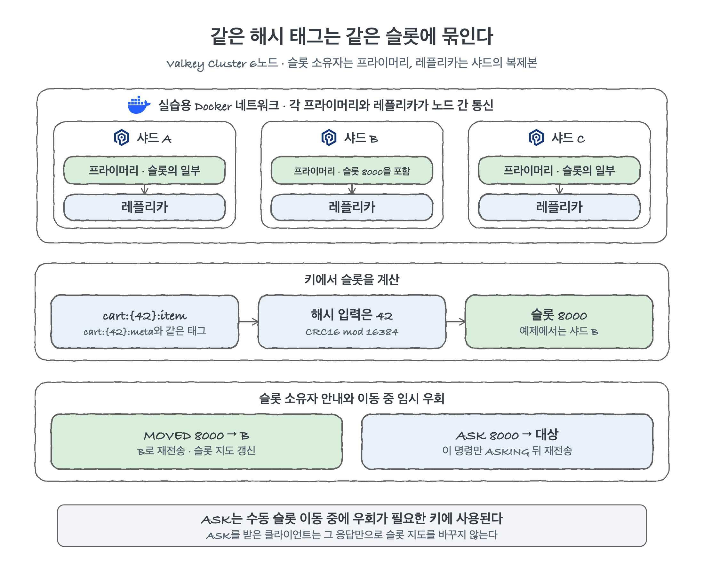
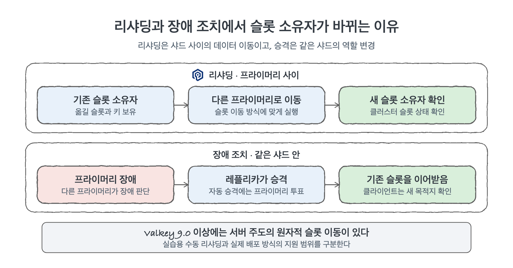
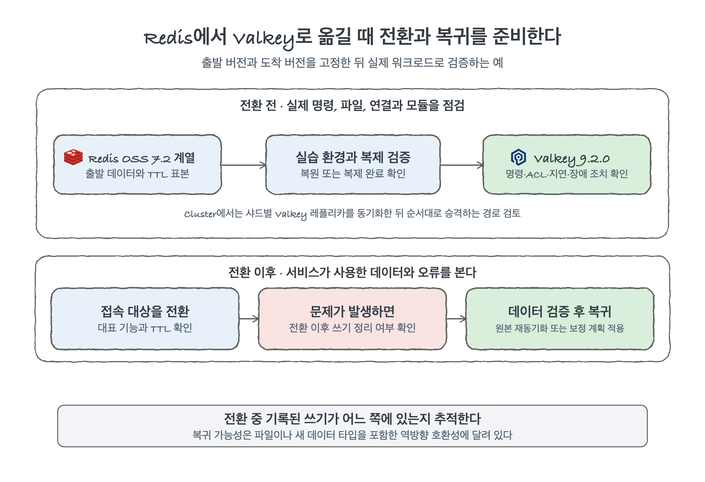

# Valkey Cluster Sharding and Redis Migration

Valkey Cluster는 키를 여러 프라이머리에 분산하고, 각 프라이머리의 레플리카를 둬 샤드 단위 장애에 대응한다. 운영에서는 슬롯 수와 함께 실제 키의 분포, 트래픽, 레플리카의 장애 도메인을 확인한다.

## 1. Docker에서 6노드 클러스터 만들기

3개 프라이머리와 프라이머리당 레플리카 1개를 구성한다. 이 실습에서는 노드 사이의 슬롯 이동과 주소 안내가 동작하도록 모두 같은 Docker 네트워크에 두고, 클라이언트도 컨테이너 내부에서 실행한다. 명령 포트와 노드 간 Cluster Bus가 서로 닿아야 한다. [Cluster 튜토리얼](https://valkey.io/topics/cluster-tutorial/)

```bash
docker network create valkey-cluster-lab

for n in 1 2 3 4 5 6; do
  docker run -d --name "valkey-c$n" --network valkey-cluster-lab \
    valkey/valkey:9.2.0 valkey-server \
    --cluster-enabled yes --cluster-config-file nodes.conf \
    --cluster-node-timeout 5000 --save "" --appendonly no
done

docker exec valkey-c1 valkey-cli --cluster create \
  valkey-c1:6379 valkey-c2:6379 valkey-c3:6379 \
  valkey-c4:6379 valkey-c5:6379 valkey-c6:6379 \
  --cluster-replicas 1 --cluster-yes

docker exec valkey-c1 valkey-cli CLUSTER INFO
docker exec valkey-c1 valkey-cli CLUSTER NODES
```

`cluster_state:ok`, `cluster_slots_assigned:16384`, `cluster_known_nodes:6`을 확인한다. 레플리카가 해당 프라이머리와 연결을 마칠 때까지 잠시 기다린다.

## 2. Hash slot, MOVED, ASK, hash tag

키는 16,384개 슬롯 중 하나에 배정된다. Cluster는 슬롯별로 담당 프라이머리를 관리한다. 일반 클라이언트가 틀린 노드에 명령을 보내면 `MOVED`와 슬롯 소유 노드 주소를 받는다. Cluster를 지원하는 클라이언트는 슬롯 정보를 갱신하고 다시 요청한다. 슬롯 이동 중 `ASK`를 받으면 해당 요청을 대상 노드에 `ASKING`과 함께 보내고, 그 응답만으로 슬롯 소유자를 바꾸지 않는다. [Cluster specification](https://valkey.io/topics/cluster-spec/)

```bash
docker exec valkey-c1 valkey-cli CLUSTER KEYSLOT 'cart:{42}:item'
docker exec valkey-c1 valkey-cli CLUSTER KEYSLOT 'cart:{42}:meta'

docker exec valkey-c1 valkey-cli SET 'cart:{42}:item' sku-101
docker exec valkey-c1 valkey-cli -c SET 'cart:{42}:item' sku-101
docker exec valkey-c1 valkey-cli -c SET 'cart:{42}:meta' active

docker exec valkey-c1 valkey-cli -c MGET 'cart:{42}:item' 'cart:{42}:meta'
docker exec valkey-c1 valkey-cli -c MGET 'cart:{42}:item' 'cart:{43}:item'
```

두 `{42}` 키는 슬롯 8000에 속한다. 초기 배치에서 이 슬롯은 `valkey-c2`에 있으므로 `-c` 없이 `valkey-c1`에 보낸 쓰기는 `MOVED`를 받는다. 마지막 `MGET`의 두 키는 다른 슬롯이어서 `CROSSSLOT`을 받는다. 동일한 장바구니처럼 함께 갱신해야 하는 키는 같은 태그를 쓰고, 서로 독립적인 장바구니는 태그를 나눠 한 슬롯에 집중되지 않도록 한다.



그림의 근거 · [Valkey Cluster specification](https://valkey.io/topics/cluster-spec/) · [Valkey Cluster tutorial](https://valkey.io/topics/cluster-tutorial/) · [Valkey CLUSTER KEYSLOT](https://valkey.io/commands/cluster-keyslot/)

## 3. 리샤딩과 장애 조치

리샤딩은 슬롯과 해당 키를 다른 프라이머리로 옮긴다. 아래에서는 독립 실습 클러스터의 `valkey-c1`에서 `valkey-c2`로 슬롯 하나를 보낸다. 이동 후에는 `--cluster check`로 슬롯 범위를 검증한다.

```bash
from_id=$(docker exec valkey-c1 valkey-cli --raw CLUSTER MYID)
to_id=$(docker exec valkey-c2 valkey-cli --raw CLUSTER MYID)

docker exec valkey-c1 valkey-cli --cluster reshard valkey-c1:6379 \
  --cluster-from "$from_id" --cluster-to "$to_id" --cluster-slots 1 --cluster-yes
docker exec valkey-c1 valkey-cli --cluster check valkey-c1:6379
```

Valkey 9.0부터 서버가 슬롯을 원자적으로 이동시키는 별도 기능도 제공한다. 사용 중인 제품·CLI·서비스가 어떤 방식을 지원하는지 확인한다. [Valkey 9.0](https://valkey.io/download/9.0/) · [Cluster 사양의 슬롯 이동](https://valkey.io/topics/cluster-spec/)

장애 조치에서는 기존 프라이머리가 담당하던 슬롯을 레플리카가 물려받는다. 계획된 승격은 `CLUSTER NODES`와 `ROLE`로 연결이 정상인 레플리카를 확인한 뒤 그 노드에서 `CLUSTER FAILOVER`를 실행한다. 실행 후 새 프라이머리와 슬롯 범위를 확인한다. 프라이머리 장애 시 자동 승격에는 충분한 수의 프라이머리 투표가 필요하다. [CLUSTER FAILOVER](https://valkey.io/commands/cluster-failover/)

| 구성 | 선택 기준 |
| --- | --- |
| Sentinel | 데이터셋이 한 프라이머리에 들어가고, 복제를 통한 장애 조치가 필요하다. |
| Cluster | 여러 프라이머리에 데이터나 쓰기 부하를 나눠야 한다. 클라이언트와 다중 키 연산도 슬롯을 고려해야 한다. |



그림의 근거 · [Valkey Cluster specification](https://valkey.io/topics/cluster-spec/) · [Valkey 9.0 릴리스](https://valkey.io/download/9.0/) · [Valkey CLUSTER FAILOVER](https://valkey.io/commands/cluster-failover/)

## 4. I/O 스레드와 처리량 측정

8.0은 비동기 I/O 스레딩을 도입했고, 9.1은 I/O 처리 모델을 개선했다. I/O 스레드는 네트워크 처리를 분담하지만 비싼 명령이 데이터 경로를 점유하는 문제까지 해결하지는 않는다. 공개된 백만 단위 처리량은 특정 하드웨어·연결 수·요청 크기의 벤치마크 결과다. [Valkey 8.0](https://valkey.io/download/8.0/) · [Valkey 9.1](https://valkey.io/download/9.1/)

임시 노드에서 스레드 1개와 4개를 같은 조건으로 비교한다. 운영 데이터가 없는 실습용 인스턴스이며 벤치마크 명령이 값을 쓴다.

```bash
for threads in 1 4; do
  name="valkey-io-lab-$threads"
  docker run --rm -d --name "$name" --network none \
    valkey/valkey:9.2.0 valkey-server --io-threads "$threads" \
    --save "" --appendonly no
  docker exec "$name" valkey-benchmark -n 10000 -c 50 -r 1000 -t set,get -P 1 -q
  docker stop "$name"
done
```

같은 명령 조합, 요청 크기, 동시 연결 수, 파이프라인 깊이에서 반복 측정한다. `-q`를 빼면 지연 분포도 확인할 수 있다. 별도 클라이언트에서 측정하면 네트워크와 TLS 비용을 함께 포함할 수 있다. 단일 Hot Key, 긴 Lua, 저장 장치 병목은 각각 별도 지표로 확인한다. [Valkey benchmark](https://valkey.io/topics/benchmark/)

## 5. 버전 차이와 Redis 마이그레이션

| Valkey 버전 | 실습과 관련된 변화 |
| --- | --- |
| [7.2](https://valkey.io/download/7.2/) | Redis OSS 7.2.4의 프로토콜·명령·파일 형식을 바탕으로 시작했다. |
| [8.0](https://valkey.io/download/8.0/)·[8.1](https://valkey.io/download/8.1/) | 비동기 I/O를 도입하고, 해시 테이블과 TLS 연결 처리 등을 개선했다. |
| [9.0](https://valkey.io/download/9.0/)·[9.1](https://valkey.io/download/9.1/) | 원자적 슬롯 이동, Hash 필드 TTL, 추가 조건부 명령과 I/O 스레딩 변경을 제공한다. |
| [9.2](https://valkey.io/download/9.2/) | 선택형 forkless 스냅샷과 서버의 Hot Key 추적을 제공한다. |

Redis OSS 7.2 계열에서 옮길 때는 클라이언트, RDB·AOF, ACL, Lua, 모듈, Sentinel과 Cluster 주소 노출을 각각 검증한다. 더 최신 Redis의 기능이나 영속 파일, Valkey 고유 데이터 타입을 사용한 뒤의 역방향 복원은 이 호환 기준에 포함해서 판단하지 않는다. 독립 노드는 복제 또는 스냅샷 복원 방식으로 검증한다. Cluster는 목적지 레플리카를 추가해 복제가 끝난 뒤 순서대로 승격하는 경로를 검토한다.

전환 전 실제 명령 목록과 표본 데이터로 읽기·쓰기·TTL·장애 조치를 검사한다. 전환 후 대표 키와 만료, 애플리케이션 오류를 확인하고, 되돌릴 때 전환 이후 쓰기를 어떻게 복구할지 미리 정한다. [Redis에서 Valkey로 마이그레이션](https://valkey.io/topics/migration/)



그림의 근거 · [Valkey Redis migration](https://valkey.io/topics/migration/) · [Valkey 9.2 릴리스](https://valkey.io/download/9.2/)
